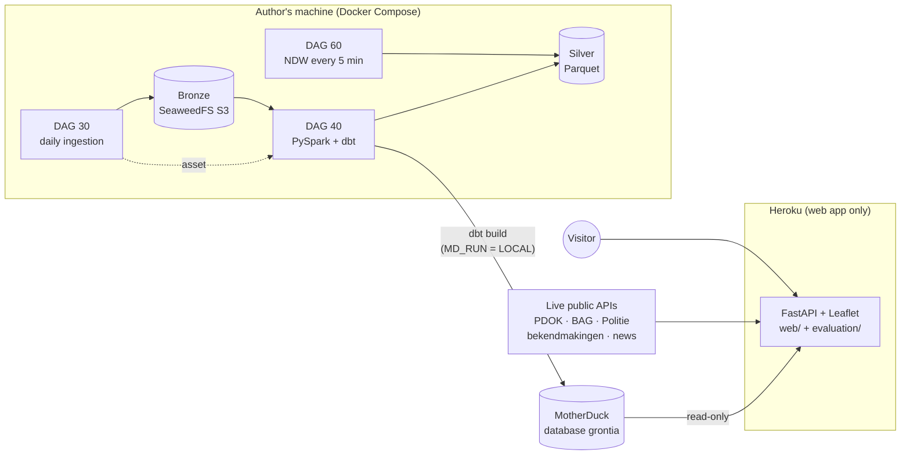

<p align="center"></p>

<p align="center">
  <b>Is this Dutch home fairly priced? Is the rent legal?</b><br>
  An end-to-end data engineering project built only with open government data and free, open-source tools.
</p>

<p align="center">
  <a href="https://grontia-304a9d81f22f.herokuapp.com/"></a>
  
  
  
  
  
</p>

---

## What it is

**Grontia** answers two questions about any home in the Netherlands:

- **Buying:** is the asking price in line with what the home is worth?
- **Renting:** is the asked rent within the legal maximum set by the Dutch points system (WWS)?

Around those answers it shows a 5-year outlook, the neighbourhood (income, livability, safety, price trend), official notices and local news, and exports a PDF report, in English and Dutch.

Behind the website sits a real data platform: a daily batch pipeline and a near real-time one, a medallion lake (bronze, silver, gold), 21 dbt models guarded by 122 data-quality tests, alerting, CI/CD and a deployed web app.

**Try it:** [grontia-304a9d81f22f.herokuapp.com](https://grontia-304a9d81f22f.herokuapp.com/)

> **Project status.** Grontia is a portfolio and learning project, kept online for reference. It is not a commercial product and is maintained on a best-effort basis. The pipeline runs on the author's own machine, so the data on the live site can be a few days old.

---

## Contents

1. [Highlights](#-highlights)
2. [How it fits together](#-how-it-fits-together)
3. [Tech stack](#-tech-stack)
4. [Scheduling](#-scheduling)
5. [Data sources](#-data-sources)
6. [Pipeline: bronze, silver, gold](#-pipeline-bronze-silver-gold)
7. [Data quality and observability](#-data-quality-and-observability)
8. [Evaluation engine](#-evaluation-engine)
9. [Web app](#-web-app)
10. [Deployment and CI/CD](#-deployment-and-cicd)
11. [Run it yourself](#-run-it-yourself)
12. [Repository layout](#-repository-layout)
13. [Lessons learned](#-lessons-learned)
14. [Reading the code](#-reading-the-code)
15. [History](#-history)
16. [Disclaimer and license](#-disclaimer-and-license)

---

## ✨ Highlights

- **Config-driven ingestion.** 14 datasets from 5 public sources are declared in one YAML catalog; the daily DAG generates its tasks from it.
- **Data-aware scheduling.** The silver and dbt DAG starts when the ingestion DAG publishes an Airflow 3 *asset*, never on a half-written bronze layer.
- **Hybrid local + cloud.** Heavy processing runs locally for free; only the finished tables go to MotherDuck, and only the web app runs in the cloud.
- **Quality gates.** Wrong data stops the build and yesterday's tables stay online; stale data only warns. Every test result is kept in a history table.
- **Near real-time traffic.** A second pipeline takes a snapshot of ~20,000 road sensors every 5 minutes and rolls it up per hour.
- **Rules as data.** The 2026 rent law and transaction costs live in versioned YAML/CSV files, not in code.
- **Privacy and legality by design.** The site stores nothing a visitor sends, never scrapes listing portals and never queries the WOZ register automatically (forbidden by art. 40a of the Wet WOZ).

---

## 🧭 How it fits together

Three places, each doing one job:



| Part | Where | What it does |
|---|---|---|
| Data pipeline (Airflow, PySpark, dbt, SeaweedFS) | The author's machine | Collects open data every day, cleans it, tests it and publishes the marts to MotherDuck |
| Warehouse | MotherDuck (free plan), database `grontia` | Staging and mart tables plus the history of every data-quality test |
| Web app | Heroku, EU region | Reads MotherDuck (read-only) and live public APIs; stores nothing a visitor sends |

The local S3 store is never exposed to the internet. MotherDuck's cloud can't reach it, so dbt reads the silver files on the local machine (`MD_RUN = LOCAL`) and only uploads the results. If the machine is off, the site keeps serving the last published data.

---

## 🧰 Tech stack

| Layer | Tools |
|---|---|
| Orchestration | Apache Airflow 3.0.6 (LocalExecutor, assets), PostgreSQL for Airflow's metadata |
| Storage | SeaweedFS (S3-compatible object store), Parquet |
| Processing | PySpark 3 with S3A |
| Transformation and tests | dbt with dbt-duckdb, custom generic tests, an `on-run-end` observability hook |
| Warehouse | DuckDB locally, MotherDuck in the cloud |
| Web | FastAPI, Uvicorn, Leaflet with PDOK base maps, vanilla JavaScript |
| Infrastructure | Docker Compose on WSL2, autoheal, Heroku (web app only) |
| CI/CD | GitHub Actions: DAG and dbt validation, security scan, automatic Heroku deploy |

---

## ⏰ Scheduling

| DAG | Schedule | What it does |
|---|---|---|
| `30_multi_source_daily_ingestion` | `@daily` (00:00 UTC) | Fetches every dataset in the catalog into bronze, validates each one, then publishes the asset `s3://bronze/daily` |
| `40_silver_and_marts` | When that asset is published | Bronze → silver (PySpark) → `ensure_warehouse` → `dbt build` (models + 122 tests) → `check_data_quality` |
| `60_ndw_traffic_live` | `*/5 * * * *` (every 5 minutes) | NDW traffic snapshot → hourly rollup per measurement site → prune old files |
| `50_evaluate_address` | Manual (form in the Airflow UI) | One address evaluation, written to the warehouse volume |

**A normal day.** At 00:00 UTC the scheduler starts DAG 30. When its last task publishes the asset, DAG 40 starts within seconds and the new tables are on MotherDuck about two minutes later. Reprocessing a past day is a manual DAG 40 run with `{"ingestion_date": "YYYY-MM-DD"}`.

**When the machine is off.** Nothing runs. With `catchup=False`, Airflow does not replay every missed day: when the stack comes back it runs the most recent interval once. The freshness tests warn when data gets old, and the traffic pipeline simply has a gap.

**Staying up.** Every service has `restart: unless-stopped`, an `autoheal` container restarts anything that turns unhealthy, and `scripts/local/register-wsl-autostart.ps1` starts WSL (and with it Docker) when Windows logs in.

---

## 📊 Data sources

| Source | What | How | Used for |
|---|---|---|---|
| **CBS** (Statistics Netherlands) | Neighbourhood key figures, WOZ values, housing stock, household income, sale prices, price index, prices by home type, rent increase, municipality → province | OData, daily into bronze | Valuation, neighbourhood overview, outlook |
| **Leefbaarometer 3.0** (Ministry BZK) | Livability score and five dimensions per neighbourhood, 2002–2024 | Zip, downloaded only when a new version appears | Livability |
| **PDOK / BAG** | Buildings and address objects | WFS into bronze (a 2×2 km area); live OGC API per address in the web app | Floor area, build year, use |
| **PDOK Locatieserver**, **CBS Wijken en Buurten** | Address search, neighbourhood outline | Live, per request | Address lookup, map, dwelling sizes |
| **Politie** (CBS 47022NED) | Registered crime per neighbourhood and month | Live, per request | Safety |
| **officielebekendmakingen.nl**, **Google News RSS** | Municipal notices, headlines | Live, per request | News |
| **KNMI** | Daily weather, all stations | CSV, daily | Weather mart |
| **NDW** | Traffic speed and flow, ~20k sites | DATEX II XML, daily raw + every 5 minutes | Traffic profile mart |

Datasets are declared in [`orchestration/airflow/include/configs/datasets.yml`](orchestration/airflow/include/configs/datasets.yml): adding a CBS table usually means editing only that file. All data belongs to its publishers and is used under their open-data terms.

Grontia never visits listing portals (Funda, Pararius, …). A visitor can upload a listing PDF instead; it is read in memory and discarded.

---

## 🧱 Pipeline: bronze, silver, gold

| Layer | Content | Where |
|---|---|---|
| **Bronze** | Raw files exactly as the source sent them, one folder per day | `s3://bronze/{source}/{source}_bronze/{dataset}/ingestion_date=YYYY-MM-DD/` |
| **Silver** | Flattened, typed, deduplicated Parquet with ingestion metadata | `s3://silver/{source}/{dataset}/` |
| **Gold** | dbt staging models and marts | MotherDuck (`main_STAGING`, `main_MARTS`, `main_OBSERVABILITY`) or a local DuckDB file |

Re-running a day is safe at every layer: ingestion clears the day's bronze folder before writing, and Spark overwrites only that day's silver partition (`partitionOverwriteMode=dynamic`).

dbt has **21 models**: 15 staging models (one per dataset) and 6 marts:

| Mart | Answers |
|---|---|
| `mart_neighbourhood_reference` | What does an average home cost here today? Municipal sale price × regional index × the neighbourhood's WOZ ratio |
| `mart_livability` | How livable is the neighbourhood, nationally ranked, and is it improving? |
| `mart_housing_market` | Housing stock by tenure with WOZ |
| `mart_regional_dashboard` | Population, WOZ and income per region and period |
| `mart_traffic_site_profile` | Typical speed and flow per NDW site by weekday/weekend and hour |
| `mart_weather_summary` | Daily weather per station |

Every silver read goes through the `read_silver()` macro, so switching between the local DuckDB file and MotherDuck changes no SQL.

---

## ✅ Data quality and observability

- **122 dbt tests** on every staging model and mart: grain uniqueness (`unique_combination`), value ranges (`expect_between`), minimum row counts, referential integrity and freshness (`expect_recent`). Custom generic tests live in `analytics/dbt/macros/tests/`.
- **Policy:** wrong data stops the build (yesterday's marts stay online); stale data only warns.
- **History:** an `on-run-end` hook writes every model and test result to `main_OBSERVABILITY.dbt_run_results`.
- **Alerts:** failures and warnings in DAGs 30 and 40 go to the task log and, when configured, to a Slack-compatible webhook and by e-mail over SMTP (see `.env.example`).
- The tests already caught a real bug: KNMI codes "less than 0.05 mm" as `-1`, which showed up as negative rain.

---

## 🧮 Evaluation engine

`evaluation/` turns a postcode and house number into one JSON document, used by the CLI, the web app and DAG 50:

| Step | How |
|---|---|
| Address and home | PDOK Locatieserver and BAG: floor area, build year, use, apartment or not |
| Value | A neighbourhood model (average WOZ of the neighbourhood, indexed, adjusted for home type and size), the indexed WOZ of the home and a comparable sale. The centre is the most specific estimate available; the range is ±20%, ±10% or ±7% to match. Addresses the BAG does not list as a home are rejected |
| Legal rent | The 2026 WWS points system (`evaluation/rules/wws_2026.yml`) in three scenarios; ≤143 points social, 144–186 mid-rent, ≥187 free sector |
| Outlook | `evaluation/outlook.py`: three 5-year growth scenarios, market rent, gross yield and the return after transfer tax (`evaluation/rules/costs_2026.yml`) |
| Context | Livability, crime, key figures, official notices and headlines; an optional source that fails never sinks the evaluation |

```bash
python -m evaluation --postcode 1017GL --number 12 --asking-price 450000 --out result.json
```

**Known limit.** There is no open data on individual sale prices in the Netherlands (Kadaster and NVM data are paid), so the valuation's real error can't be measured. The wide ranges are deliberate.

---

## 🗺️ Web app

English and Dutch, on a full-screen PDOK map, in the colours of the Dutch flag.

- **Search** an address, or **upload a listing PDF** and check the form it fills in.
- **Summary**: four headline numbers coloured by state (value, legal rent, livability, crime) and the verdict.
- **Detailed view**: a full-screen report in six sections with larger charts, the valuation and WWS tables and an explanation on every card.
- **Export PDF**: the same content as an A4 report.
- **About** page with the method, the data, privacy and limits.

API: `POST /api/evaluate`, `POST /api/listing`, `GET /api/news`, and the address search `GET /api/suggest`, `/api/lookup`, `/api/locate` (proxied to PDOK with hedged requests, because its search intermittently hangs). Interactive docs at `/api/docs`. Protections: per-IP rate limit, an 8-second timeout per external source, and a read-only warehouse connection.

---

## 🚀 Deployment and CI/CD

| Workflow | When | What |
|---|---|---|
| `ci-cd.yml` | Every push and pull request | Compiles the DAGs, validates the catalog, `dbt parse`, security scan |
| `pr-validation.yml` | Pull requests touching the pipeline | Loads the DAGs in a DagBag, validates the catalog, `dbt parse` |
| `deploy-web.yml` | Push to `main` that touches `web/`, `evaluation/` or the Heroku files | Installs the Heroku requirements, imports the app, tests the PDF parser, deploys and waits for `/api/health` |
| `security-scan.yml` | Weekly | Bandit and Safety |

Only the web app ships to Heroku: `.slugignore` leaves the pipeline out and the root `requirements.txt` has seven packages. Step by step: [`docs/deploy-heroku.md`](docs/deploy-heroku.md).

---

## ⚡ Run it yourself

You need Docker (on Windows, Docker in WSL2) and about 6 GB of free RAM.

```bash
git clone https://github.com/luk14236/grontia.git
cd grontia
cp .env.example orchestration/airflow/.env      # optional: add MOTHERDUCK_TOKEN
cd orchestration/airflow && docker compose up -d
```

| What | Where |
|---|---|
| Airflow UI | http://localhost:8080 · user `admin`; the password is generated on first start: `docker exec airflow-airflow-api-server-1 cat /opt/airflow/simple_auth_manager_passwords.json.generated` |
| S3 file browser | http://localhost:8888/buckets/ |
| Web app (local copy) | http://localhost:8000 |

In the Airflow UI, unpause the DAGs and trigger `30_multi_source_daily_ingestion`; DAG 40 follows by itself. With `GRONTIA_DBT_TARGET=dev` the marts are built into a local DuckDB file; with `motherduck` they are published to MotherDuck.

---

## 📁 Repository layout

```
orchestration/airflow/   Airflow image, Docker Compose, DAGs (30, 40, 50, 60), dataset catalog, alerts
processing/local/        PySpark bronze -> silver
analytics/dbt/           dbt staging models, marts, custom tests, observability hook
evaluation/              Evaluation engine: value, WWS rent, outlook, context; rules as YAML/CSV
web/                     FastAPI app and the front end (map, summary, detailed view, PDF report)
docs/                    Full documentation (Portuguese), deployment, brand, study guide
scripts/local/           WSL autostart for Windows
.github/workflows/       CI, PR validation, Heroku deploy, security scan
.claude/skills/          property-report skill for Claude Code (evaluation JSON -> written report)
processing/databricks/   Legacy code from the project's Azure/Databricks phase
```

---

## 💡 Lessons learned

- **Schedule on data, not on the clock.** Triggering the transform DAG from an asset removed every "ran before the data arrived" problem.
- **Keep bronze immutable.** Being able to rebuild silver and gold from raw files made every fix cheap.
- **Stale is not wrong.** Splitting test severities into error (stop the build) and warn (tell me) kept the site useful while the pipeline machine was off.
- **Read the platform limits first.** Heroku's 30-second request limit shaped the API: news loads in a second request, and every external call has a timeout.
- **Hedge flaky dependencies.** PDOK's address search sometimes hangs; sending a second request after a short delay and taking the first answer fixed it.
- **Check that a setting is really applied.** MotherDuck silently ignored `access_mode=READ_ONLY` as a URL parameter; it only works in the connection config.
- **Know the law around the data.** The per-home WOZ is the best open signal for a home's value, but automated lookups are illegal, so the user types it in.
- **Free tools go a long way.** The whole platform runs on open-source software, a free warehouse plan and one small web dyno.

---

## 📚 Reading the code

A suggested order, from the data in to the page out:

1. **Ingestion:** [`datasets.yml`](orchestration/airflow/include/configs/datasets.yml), then [`dags/30_multi_source_daily_ingestion.py`](orchestration/airflow/dags/30_multi_source_daily_ingestion.py).
2. **Silver:** [`processing/local/bronze_to_silver.py`](processing/local/bronze_to_silver.py).
3. **Gold:** [`analytics/dbt/macros/read_silver.sql`](analytics/dbt/macros/read_silver.sql), a staging model such as `models/staging/cbs/stg_cbs_average_woz_value.sql`, then `models/marts/mart_neighbourhood_reference.sql`.
4. **Quality:** `analytics/dbt/macros/tests/`, the `schema.yml` files, `macros/observability/log_run_results.sql` and [`dags/grontia_alerts.py`](orchestration/airflow/dags/grontia_alerts.py).
5. **Orchestration:** [`dags/40_silver_and_marts.py`](orchestration/airflow/dags/40_silver_and_marts.py) and [`dags/60_ndw_traffic_live.py`](orchestration/airflow/dags/60_ndw_traffic_live.py).
6. **Evaluation:** `evaluation/__main__.py` (`run()`), then `valuation.py`, `wws.py`, `outlook.py` and `sources.py`.
7. **Serving:** `web/app.py`, `web/listing.py`, then `web/static/app.js`.
8. **Shipping:** [`docs/deploy-heroku.md`](docs/deploy-heroku.md) and `.github/workflows/deploy-web.yml`.

An interactive study guide in Portuguese is in [`docs/study/grontia-estudo.html`](docs/study/grontia-estudo.html); open it in a browser. Each commit message in `git log` explains what changed and why.

---

## 🧪 History

| Phase | Status |
|---|---|
| 1. Local platform (Airflow 3, S3 storage, Docker) | ✅ |
| 2. Batch ingestion into bronze | ✅ |
| 3. Silver and dbt models | ✅ |
| 4. Data quality and observability (122 tests, run history, alerts) | ✅ |
| 5. Warehouse on MotherDuck, published from the local Airflow | ✅ |
| 6. Near real-time NDW traffic (every 5 minutes) | ✅ |
| 7. Address evaluation (CLI, DAG 50) | ✅ |
| 8. Public web app on Heroku with automatic deploys, PDF report, EN/NL | ✅ |

The project started on Azure and Databricks and moved to a fully open-source local stack; the legacy code is still in `processing/databricks/`. A possible next step is splitting `evaluation/` into a country-agnostic core and country adapters, for a German version.

---

## ⚖️ Disclaimer and license

Grontia gives estimates from public statistics. It is not financial, legal or valuation advice, and it is not affiliated with the Dutch government or any of the data publishers. For a binding rent check, use the Huurcommissie's official Huurprijscheck at [huurcommissie.nl](https://www.huurcommissie.nl).

AI assistants were used to speed up research, documentation, code and design. The author decided the architecture, reviewed the changes and runs the platform.

This repository is public for reference and learning. It has no open-source license, so all rights are reserved: you are welcome to read the code and learn from it, but please ask before reusing it.
