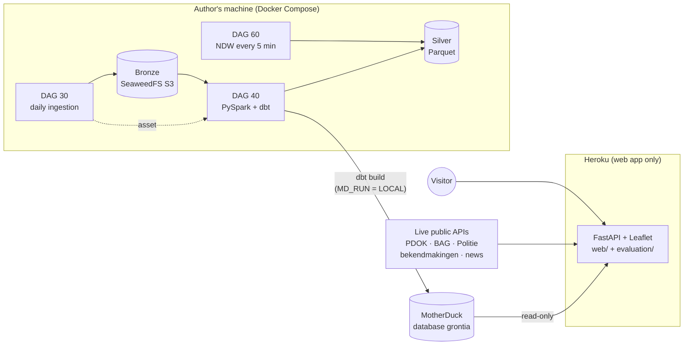

<p align="center"></p>

# Grontia

**Grontia** answers two questions about any home in the Netherlands, using only open government data:

- **Buying:** is the asking price in line with what the home is worth?
- **Renting:** is the asked rent within the legal maximum?

Around those answers it shows a 5-year outlook, the neighbourhood (income, livability, safety, price trend), official notices and news, and a PDF report. It is also a hands-on data engineering project: a real batch and near real-time pipeline, built only with free and open-source tools.

**Live site:** https://grontia-304a9d81f22f.herokuapp.com/ · Full documentation (Portuguese): [`docs/PROJETO_COMPLETO.md`](docs/PROJETO_COMPLETO.md)

---

## Contents

1. [How it fits together](#-how-it-fits-together)
2. [Scheduling: when each pipeline runs](#-scheduling-when-each-pipeline-runs)
3. [Data sources](#-data-sources)
4. [Pipeline: bronze, silver, gold](#-pipeline-bronze-silver-gold)
5. [Data quality and observability](#-data-quality-and-observability)
6. [Evaluation engine](#-evaluation-engine)
7. [Web app](#-web-app)
8. [Deployment and CI/CD](#-deployment-and-cicd)
9. [Brand](#-brand)
10. [Quick start](#-quick-start)
11. [Repository layout](#-repository-layout)
12. [Study guide](#-study-guide)
13. [Artifacts and documents](#-artifacts-and-documents)
14. [Roadmap and history](#-roadmap-and-history)

---

## 🧭 How it fits together

Three places, each doing one job:



| Part | Where | What it does |
|---|---|---|
| Data pipeline (Airflow, PySpark, dbt, SeaweedFS) | The author's machine | Collects open data every day, cleans it, tests it and publishes the marts to MotherDuck |
| Warehouse | MotherDuck (free plan), database `grontia` | Staging and mart tables plus the history of every data-quality test |
| Web app | Heroku, EU region | Reads MotherDuck (read-only) and live public APIs; stores nothing a visitor sends |

The local S3 store is never exposed: MotherDuck's cloud can't reach it, so dbt reads the silver files on the local machine (`MD_RUN = LOCAL`) and only uploads results.

---

## ⏰ Scheduling: when each pipeline runs

| DAG | Schedule | What it does |
|---|---|---|
| `30_multi_source_daily_ingestion` | `0 0 * * *` (daily at 00:00 UTC) | Fetches every dataset in the catalog into bronze, validates each one, then publishes the asset `s3://bronze/daily` |
| `40_silver_and_marts` | When that asset is published | Bronze → silver (PySpark) → `ensure_warehouse` → `dbt build` (models + 122 tests) → `check_data_quality` |
| `60_ndw_traffic_live` | `*/5 * * * *` (every 5 minutes) | NDW traffic snapshot → hourly rollup per measurement site → prune old files |
| `50_evaluate_address` | Manual (form in the Airflow UI) | One address evaluation, written to the warehouse volume |

**How a day works.** At 00:00 UTC the scheduler creates the run for the day that just ended (`logical_date` = that midnight). DAG 30 needs no clock of its own for DAG 40: when its last task publishes the asset, DAG 40 starts within seconds, so silver and the marts are never built on a half-finished bronze. Reprocessing a past day is a manual DAG 40 run with `{"ingestion_date": "YYYY-MM-DD"}`.

**When the computer is off or hibernating.** Nothing runs while the machine sleeps. `catchup=False` means Airflow does not replay every missed day: when the stack comes back it runs only the most recent missed interval, once. Example from 20 October 2026: the PC was hibernating at midnight, Airflow ran DAG 30 at 16:29 UTC when it woke up, and DAG 40 followed at 16:30. The website keeps serving the last published data in the meantime; the freshness tests warn if the data gets older than two days. DAG 60 simply has a gap for the hours the machine was off; its hourly rollup catches up on any hour that still has snapshots (up to two days back).

**Staying up.** Every service has `restart: unless-stopped`, an `autoheal` container restarts anything that turns unhealthy, and `scripts/local/register-wsl-autostart.ps1` starts WSL (and with it Docker) when Windows logs in.

---

## 📊 Data sources

| Source | What | How | Used for |
|---|---|---|---|
| **CBS** (Statistics Netherlands) | Neighbourhood key figures, WOZ values, housing stock, household income, sale prices, price index, prices by home type, rent increase, municipality → province | OData, daily into bronze | Valuation, neighbourhood overview, outlook |
| **Leefbaarometer 3.0** (Ministry BZK) | Livability score and five dimensions per neighbourhood, 2002–2024 | Zip, downloaded only when a new version appears | Livability |
| **PDOK / BAG** | Buildings and address objects | WFS into bronze (a 2×2 km area); live OGC API per address in the web app | Floor area, build year, use |
| **PDOK Locatieserver**, **CBS Wijken en Buurten** | Address search, neighbourhood outline | Live, per request | Address lookup, map, dwelling sizes |
| **Politie** (CBS 47022NED) | Registered crime per neighbourhood and month | Live, per request | Safety |
| **officielebekendmakingen.nl**, **Google News RSS** | Municipal notices, headlines | Live, per request | News |
| **KNMI** | Daily weather, all stations | CSV, daily | Weather mart |
| **NDW** | Traffic speed and flow, ~20k sites | DATEX II XML, daily raw + every 5 minutes | Traffic profile mart |

Datasets are declared in [`orchestration/airflow/include/configs/datasets.yml`](orchestration/airflow/include/configs/datasets.yml): adding a CBS table usually means editing only that file. Grontia never visits listing portals (Funda, Pararius, …); a visitor can upload a listing PDF, which is read in memory and discarded.

---

## 🧱 Pipeline: bronze, silver, gold

| Layer | Content | Where |
|---|---|---|
| **Bronze** | Raw files exactly as the source sent them, one folder per day | `s3://bronze/{source}/{source}_bronze/{dataset}/ingestion_date=YYYY-MM-DD/` |
| **Silver** | Flattened, typed metadata, deduplicated Parquet | `s3://silver/{source}/{dataset}/` |
| **Gold** | dbt marts | MotherDuck (`main_STAGING`, `main_MARTS`, `main_OBSERVABILITY`) or a local DuckDB file |

dbt has **21 models**: 15 staging models (one per dataset; the hourly traffic one is ephemeral) and 6 marts:

| Mart | Answers |
|---|---|
| `mart_neighbourhood_reference` | What does an average home cost here today? Municipal sale price × regional index × the neighbourhood's WOZ ratio |
| `mart_livability` | How livable is the neighbourhood, nationally ranked, and is it improving? |
| `mart_housing_market` | Housing stock by tenure with WOZ |
| `mart_regional_dashboard` | Population, WOZ and income per region and period |
| `mart_traffic_site_profile` | Typical speed and flow per NDW site by weekday/weekend and hour |
| `mart_weather_summary` | Daily weather per station |

Every silver read goes through the `read_silver()` macro, so switching between the local DuckDB file and MotherDuck changes no SQL.

---

## ✅ Data quality and observability

- **122 dbt tests** on every staging model and mart: grain uniqueness (`unique_combination`), value ranges (`expect_between`), minimum row counts, referential integrity and freshness (`expect_recent`). Custom generic tests live in `analytics/dbt/macros/tests/`.
- **Policy:** wrong data stops the build (yesterday's marts stay); stale data only warns.
- **History:** an `on-run-end` hook writes every model and test result to `main_OBSERVABILITY.dbt_run_results`.
- **Alerts:** failures and warnings in DAGs 30 and 40 go to the task log and, when configured, to a Slack-compatible webhook (`GRONTIA_ALERT_WEBHOOK_URL`) and by e-mail (`GRONTIA_ALERT_EMAIL_TO` plus an SMTP app password, Gmail by default; see `.env.example`).
- The tests already caught a real bug: KNMI codes "less than 0.05 mm" as `-1`, which showed up as negative rain.

---

## 🧮 Evaluation engine

`evaluation/` turns a postcode and house number into one JSON, used by the CLI, the web app, DAG 50 and the property-report skill:

| Step | How |
|---|---|
| Address and home | PDOK Locatieserver and BAG: floor area, build year, use, apartment or not |
| Value | A neighbourhood model (average WOZ of the neighbourhood, indexed, adjusted for home type and size), the indexed WOZ of the home and a comparable sale. The centre is the most specific one given; the range is ±20%, ±10% or ±7% to match. Addresses the BAG does not list as a home are rejected |
| Legal rent | The 2026 WWS points system (`evaluation/rules/wws_2026.yml`) in three scenarios; ≤143 points social, 144–186 mid-rent, ≥187 free sector |
| Outlook | `evaluation/outlook.py`: three 5-year growth scenarios, market rent, gross yield and the return after transfer tax (2% to live in, 8% to rent out; `evaluation/rules/costs_2026.yml`) |
| Context | Livability, crime, key figures, official notices and headlines; an optional source that fails never sinks the evaluation |

Rules are versioned files: when the law changes, the YAML changes, not the code.

---

## 🗺️ Web app

English and Dutch, on a full-screen PDOK map, in the colours of the Dutch flag.

- **Search** an address (the map zooms to it as soon as you pick a suggestion) or **upload a listing PDF**; the form is filled for you to check.
- **Summary** in the side panel: four headline numbers coloured by state (value, legal rent, livability, crime) and the verdict.
- **Detailed view**: a full-screen report in six sectors (verdict, the home and its price, 5-year outlook, the neighbourhood, news, sources) with a sticky menu, larger charts, the valuation and WWS tables and an explanation on every card.
- **Hints**: every field, number and card has an ⓘ with an explanation on hover, focus or tap.
- **Export PDF**: the same cards as an A4 report, saved through the browser's print window.
- **About** page with the method, the data, privacy and limits.

API: `POST /api/evaluate`, `POST /api/listing`, `GET /api/news`, and the address search `GET /api/suggest`, `/api/lookup`, `/api/locate` (proxied to PDOK with hedged requests, because its search intermittently hangs); docs at `/api/docs`. Nothing a visitor sends is stored.

---

## 🚀 Deployment and CI/CD

| Workflow | When | What |
|---|---|---|
| `ci-cd.yml` | Every push and pull request | Compiles the DAGs, validates the catalog, `dbt parse`, security scan |
| `pr-validation.yml` | Pull requests touching the pipeline | Loads the DAGs in a DagBag, validates the catalog, `dbt parse` |
| `deploy-web.yml` | Push to `main` that touches `web/`, `evaluation/` or the Heroku files | Installs the Heroku requirements, imports the app, tests the PDF parser, deploys to Heroku and waits for `/api/health` |
| `security-scan.yml` | Weekly | Bandit and Safety |

On Heroku the app has a per-visitor rate limit, an optional site password, an 8-second timeout per external source (Heroku cuts requests at 30 s) and opens MotherDuck in read-only mode. Step by step: [`docs/deploy-heroku.md`](docs/deploy-heroku.md).

---

## 🎨 Brand

The official kit is in [`web/static/brand/`](web/static/brand/): symbol, wordmark, favicons and colours (Dutch red `#D71920`, Dutch blue `#003DA5`). Usage rules: [`docs/brand.md`](docs/brand.md).

---

## ⚡ Quick start

```bash
cp .env.example orchestration/airflow/.env      # add MOTHERDUCK_TOKEN to publish to MotherDuck

cd orchestration/airflow && docker compose up -d
#   Airflow UI   http://localhost:8080
#   S3 browser   http://localhost:8888/buckets/
#   Web app      http://localhost:8000
#   Trigger 30_multi_source_daily_ingestion; DAG 40 follows by itself
```

`GRONTIA_DBT_TARGET=dev` builds into a local DuckDB file; `motherduck` publishes to MotherDuck. Step by step: [`docs/PROJETO_COMPLETO.md`](docs/PROJETO_COMPLETO.md).

---

## 📁 Repository layout

```
orchestration/airflow/   Airflow DAGs (30, 40, 50, 60), dataset catalog, alerts, Docker Compose
processing/local/        PySpark bronze -> silver
analytics/dbt/           dbt staging, marts, custom tests, observability hook
evaluation/              Evaluation engine: value, WWS rent, outlook, context; rules as YAML/CSV
web/                     FastAPI app and the front end (map, summary, detailed view, PDF report)
docs/                    Full documentation (PT), deployment, brand, architecture decisions
.github/workflows/       CI, PR validation, Heroku deploy, security scan
.claude/skills/          property-report skill (evaluation JSON -> written report)
```

---

## 📚 Study guide

A suggested order to read the project, from the data in to the page out:

1. **The idea:** this README, then [`docs/architecture/decisions/project-structure-rationale.md`](docs/architecture/decisions/project-structure-rationale.md).
2. **Ingestion:** [`datasets.yml`](orchestration/airflow/include/configs/datasets.yml), then [`dags/30_multi_source_daily_ingestion.py`](orchestration/airflow/dags/30_multi_source_daily_ingestion.py) (catalog → tasks, asset at the end).
3. **Silver:** [`processing/local/bronze_to_silver.py`](processing/local/bronze_to_silver.py).
4. **Gold:** [`analytics/dbt/macros/read_silver.sql`](analytics/dbt/macros/read_silver.sql), one staging model (`models/staging/cbs/stg_cbs_sale_prices_by_home_type.sql`), then `models/marts/mart_neighbourhood_reference.sql`.
5. **Quality:** `analytics/dbt/macros/tests/`, the `schema.yml` files, `macros/observability/log_run_results.sql`, [`dags/grontia_alerts.py`](orchestration/airflow/dags/grontia_alerts.py).
6. **Orchestration:** [`dags/40_silver_and_marts.py`](orchestration/airflow/dags/40_silver_and_marts.py) (asset trigger, MotherDuck), [`dags/60_ndw_traffic_live.py`](orchestration/airflow/dags/60_ndw_traffic_live.py) (near real-time).
7. **Evaluation:** `evaluation/__main__.py` (`run()`), then `valuation.py`, `wws.py`, `outlook.py`, `sources.py`.
8. **Serving:** `web/app.py`, `web/listing.py`, then `web/static/app.js` and `report.js`.
9. **Shipping:** [`docs/deploy-heroku.md`](docs/deploy-heroku.md) and `.github/workflows/deploy-web.yml`.

`git log` tells the story in order: each commit message explains what changed and why.

---

## 🗂️ Artifacts and documents

| Document | What it is | Access |
|---|---|---|
| [Grontia por dentro](https://claude.ai/artifact/EGGQnrrUF8zYGPHCePd3WQ) | Technical walkthrough of every layer (PT), lessons learned and the blueprint for a German version | Anyone with the link |
| [Panorama Grontia](https://claude.ai/artifact/Ta2L9YS2pYdpEuVm7XFAsv) | Snapshot from 7 October 2026: inventory of the data, how each answer is built, which data to add next | Private (owner only) |
| Property reports | Example reports made with the property-report skill | Private: they contain a real address |
| [`docs/PROJETO_COMPLETO.md`](docs/PROJETO_COMPLETO.md) | Full documentation in Portuguese | In the repo |
| [`docs/deploy-heroku.md`](docs/deploy-heroku.md) | Web app deployment and the automatic deploy | In the repo |
| [`docs/brand.md`](docs/brand.md) | Brand colours, files and usage | In the repo |

---

## 🧪 Roadmap and history

| Phase | Status |
|---|---|
| 1. Local platform (Airflow 3, S3 storage, Docker) | ✅ |
| 2. Batch ingestion into bronze | ✅ |
| 3. Silver and dbt models | ✅ |
| 4. Data quality and observability (122 tests, run history, alerts) | ✅ |
| 5. Warehouse on MotherDuck, published from the local Airflow | ✅ |
| 6. Near real-time NDW traffic (every 5 minutes) | ✅ |
| 7. Address evaluation (CLI, DAG 50, skill) | ✅ |
| 8. Public web app on Heroku with automatic deploys, PDF report, EN/NL | ✅ |
| Next | Refactor `evaluation/` into `core` + `nl` adapters, then a German version (see *Grontia por dentro*) |

Along the way: Airflow upgraded from 3.0.0 to 3.0.6 after the DAG processor kept hanging; the news search capped for Heroku's 30-second limit; the address check now warns when the BAG says the address is not a home.

---

## 🤖 About using AI

AI assistants are used to speed up research, documentation, code and design. They accelerate the work; the author decides the architecture, reviews the changes and runs the platform.
