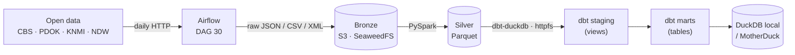

<p align="center"></p>

# Grontia

**Grontia** is an open, hands-on data engineering project that builds real batch pipelines on official open data from the Netherlands, using only free and open-source tools.

The project is public by design and evolves incrementally, documenting architecture decisions, trade-offs, and lessons learned along the way.

> Full documentation (Portuguese): [`docs/PROJETO_COMPLETO.md`](docs/PROJETO_COMPLETO.md)

---

## 🎯 Project Goal

The primary goal of Grontia is **learning through practice**.

This project exists to:
- Learn modern data engineering tools in a hands-on way
- Build realistic pipelines end to end, on real data
- Apply production-minded patterns such as data contracts, data quality, and observability
- Understand architectural trade-offs by solving real problems
- Share the learning process openly

The analytical outcome is a reference of Dutch housing prices and neighbourhood context (per municipality, district and neighbourhood), which can later support evaluating a specific address.

---

## 🧠 Principles

- **Zero cost** — no paid service is required; everything runs locally with Docker
- **Open source across the stack**
- **Real data, not simulated**
- **Problem-driven tooling** — tools are chosen for the problem, not for the résumé
- **Production mindset** — idempotent re-runs, deduplication, tests, CI

---

## 🧱 Architecture

The platform follows the **Medallion architecture** (Bronze → Silver → Gold):



| Layer | Content | Where |
|---|---|---|
| **Bronze** | Raw, as ingested from the source | `s3://bronze/{source}/{source}_bronze/{dataset}/ingestion_date=YYYY-MM-DD/` |
| **Silver** | Cleaned, deduplicated Parquet | `s3://silver/{source}/{dataset}/` |
| **Gold** | Analytical marts built by dbt | DuckDB (local) or MotherDuck (cloud) |

---

## 🛠️ Technology Stack

| Layer | Technology |
|---|---|
| Orchestration | Apache Airflow 3 (Docker Compose) |
| Object storage | SeaweedFS (S3-compatible; replaces MinIO, whose images are no longer published) |
| Processing | PySpark (`processing/local/bronze_to_silver.py`) |
| Transformations | dbt-duckdb |
| Warehouse | DuckDB (local) / MotherDuck (free tier) |
| CI | GitHub Actions |

---

## 📊 Data Sources

| Source | What | Format | Status |
|---|---|---|---|
| **CBS** (Statistics Netherlands) | Neighbourhood key figures, WOZ values, housing stock, household income, sale prices, price index, rent increase, municipality → province | OData (JSON) | ✅ |
| **PDOK / BAG** | Buildings (`pand`) and address objects (`verblijfsobject`) | WFS (GeoJSON), limited to a bbox | ✅ (central Amsterdam only) |
| **KNMI** | Daily weather, all stations | CSV | ✅ |
| **NDW** | Traffic speed and flow per measurement site (~20k sites) | DATEX II XML.gz | ✅ (every 5 minutes + daily raw snapshot) |

Datasets are declared in [`orchestration/airflow/include/configs/datasets.yml`](orchestration/airflow/include/configs/datasets.yml); adding a CBS table usually means editing only that file.

---

## 📦 dbt Models

- **Staging (12 views)** — one per dataset: rename Dutch columns to English, cast types, keep the latest snapshot per natural key.
- **Marts (4 tables)**:
  - `mart_regional_dashboard` — population, WOZ and income per region and period
  - `mart_housing_market` — housing stock by dwelling type with WOZ value
  - `mart_weather_summary` — daily weather per station
  - `mart_neighbourhood_reference` — estimated current average sale price per municipality, district and neighbourhood
  - `mart_livability` — Leefbaarometer score per region and year with national percentile and trend
  - `mart_traffic_site_profile` — typical speed and flow per NDW site by weekday/weekend and local hour (last 4 weeks)
- **Data quality (~115 tests)** — grain uniqueness, value ranges, minimum row counts, referential integrity and freshness on every staging model and mart. Data errors stop the build; staleness only warns. Every run is logged to `OBSERVABILITY.dbt_run_results`, and DAG 40 alerts on failures and warnings (set `GRONTIA_ALERT_WEBHOOK_URL` for a Slack-compatible webhook).

---

## 🚀 Quick Start

```bash
cp .env.example orchestration/airflow/.env

# 1. Airflow + S3 storage
cd orchestration/airflow && docker compose up -d
#    Airflow UI:    http://localhost:8080  (admin / admin)
#    S3 browser:    http://localhost:8888/buckets/
#    Trigger DAG `30_multi_source_daily_ingestion`

# 2. Bronze -> Silver (needs Java 11+ and pyspark)
python processing/local/bronze_to_silver.py YYYY-MM-DD

# 3. Silver -> marts
cd analytics/dbt
dbt run --target dev --profiles-dir . && dbt test --target dev --profiles-dir .

# 4. Web app
#    http://localhost:8000  (service grontia-web, localhost only)
```

DAG 40 runs steps 2 and 3 automatically after each ingestion. To publish the marts to MotherDuck instead of the local DuckDB file, set `MOTHERDUCK_TOKEN` and `GRONTIA_DBT_TARGET=motherduck` in `orchestration/airflow/.env` and recreate the containers.

Step-by-step instructions are in [`docs/PROJETO_COMPLETO.md`](docs/PROJETO_COMPLETO.md#12-como-subir-o-ambiente-local).

---

## 🗺️ Web App

`http://localhost:8000` (Docker service `grontia-web`, bound to localhost because it has no login). In English or Dutch:

- **Address:** type a street or postcode; the PDOK address search suggests matches and the map zooms to the home as soon as you pick one.
- **Listing PDF:** drop a Funda/Pararius PDF. Address, asking price or rent, deposit, floor area and energy label are pulled out and filled into the form for you to check. The PDF is read in memory and never stored.
- **Verdict:** asking price vs. the expected value range, or asked rent vs. the legal maximum (WWS points), the market rent and the deposit limit.
- **5-year outlook:** three growth scenarios and the return after transfer tax for living in the home (2%) or renting it out (8%, rent capped at the legal maximum), from `evaluation/outlook.py` (shared with the report skill).
- **Neighbourhood:** overview (income, WOZ, tenure, new build, distances), livability by dimension, crime per 1,000 residents with trend and top offences, municipal price trend, and the latest official notices and headlines, loaded after the verdict from `/api/news`. The outline of the neighbourhood is drawn on the map.
- **Two views:** a summary in the side panel (four headline numbers and the verdict) and a detailed view next to it with every section as a card, larger charts, the valuation and WWS tables and a short explanation per card.
- **Hints:** every form field, headline number and card has an ⓘ with an explanation on hover, keyboard focus or tap.
- **Export PDF:** builds a full report (summary, neighbourhood outline, valuation methods, WWS points per rubric, outlook, neighbourhood, safety, price and WOZ history, all notices and headlines with links, data periods, methodology and sources) and opens the browser's print window to save it as a PDF (`web/static/report.js`).

The API lives at `/api/evaluate` and `/api/listing` (docs at `/api/docs`) and reads the warehouse wherever DAG 40 publishes it. The page also has an **About** view that explains the project, the data and the privacy rules.

**Public deployment:** the web app runs on Heroku and reads MotherDuck; the data pipeline stays on the author's machine and refreshes MotherDuck daily. Every push to `main` that touches the web app is checked and deployed by GitHub Actions (`.github/workflows/deploy-web.yml`). See [`docs/deploy-heroku.md`](docs/deploy-heroku.md) (`Procfile`, root `requirements.txt`, rate limit, optional password, read-only MotherDuck connection).

---

## 📁 Repository Layout

```
orchestration/airflow/   Airflow DAGs, dataset catalog, Docker Compose
processing/local/        PySpark bronze -> silver
analytics/dbt/           dbt staging and marts
evaluation/              Address evaluation engine (value, legal rent, neighbourhood)
web/                     Web app: address or listing PDF -> verdict on a map (EN/PT)
docs/                    Documentation, architecture decisions, diagrams
.github/workflows/       CI (validation, dbt parse, security scan)
```

---

## 🧪 Roadmap

| Phase | Status |
|---|---|
| 1. Local platform (Airflow, S3 storage, Docker) | ✅ Done |
| 2. Batch ingestion into bronze | ✅ Done |
| 3. Modeling and transformations (silver, dbt) | ✅ Done |
| 4. Data quality and observability (broader dbt tests, freshness, alerts) | ✅ Done |
| 5. MotherDuck deployment (DAG 40 builds into MotherDuck; CI only validates) | ✅ Done |
| 6. Near real-time traffic pipeline (NDW, DAG 60 every 5 minutes) | ✅ Done |
| 7. Serving: address evaluation on top of `mart_neighbourhood_reference` (DAG 50, reads wherever DAG 40 publishes) | ✅ Done |

Grontia only uses open data. It never scrapes listing portals (Funda, Pararius, etc.).

---

## 🤖 About Using AI

AI assistants are used in this project to speed up research, documentation and architectural brainstorming. They are a productivity and learning accelerator, not a replacement for hands-on work. Pipelines are designed, run and operated by the author.
