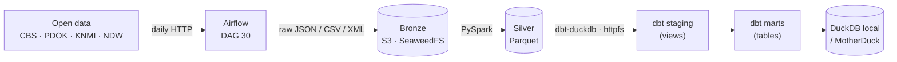

# Grontia

**Grontia** is an open, hands-on data engineering project that builds real batch pipelines on official open data from the Netherlands, using only free and open-source tools.

The project is public by design and evolves incrementally, documenting architecture decisions, trade-offs, and lessons learned along the way.

> Full documentation (Portuguese): [`docs/PROJETO_COMPLETO.md`](docs/PROJETO_COMPLETO.md)

---

## 🎯 Project Goal

The primary goal of Grontia is **learning through practice**.

This project exists to:
- Learn modern data engineering tools in a hands-on way
- Build realistic pipelines end to end, on real data
- Apply production-minded patterns such as data contracts, data quality, and observability
- Understand architectural trade-offs by solving real problems
- Share the learning process openly

The analytical outcome is a reference of Dutch housing prices and neighbourhood context (per municipality, district and neighbourhood), which can later support evaluating a specific address.

---

## 🧠 Principles

- **Zero cost** — no paid service is required; everything runs locally with Docker
- **Open source across the stack**
- **Real data, not simulated**
- **Problem-driven tooling** — tools are chosen for the problem, not for the résumé
- **Production mindset** — idempotent re-runs, deduplication, tests, CI

---

## 🧱 Architecture

The platform follows the **Medallion architecture** (Bronze → Silver → Gold):



| Layer | Content | Where |
|---|---|---|
| **Bronze** | Raw, as ingested from the source | `s3://bronze/{source}/{source}_bronze/{dataset}/ingestion_date=YYYY-MM-DD/` |
| **Silver** | Cleaned, deduplicated Parquet | `s3://silver/{source}/{dataset}/` |
| **Gold** | Analytical marts built by dbt | DuckDB (local) or MotherDuck (cloud) |

---

## 🛠️ Technology Stack

| Layer | Technology |
|---|---|
| Orchestration | Apache Airflow 3 (Docker Compose) |
| Object storage | SeaweedFS (S3-compatible; replaces MinIO, whose images are no longer published) |
| Processing | PySpark (`processing/local/bronze_to_silver.py`) |
| Transformations | dbt-duckdb |
| Warehouse | DuckDB (local) / MotherDuck (free tier) |
| CI | GitHub Actions |

---

## 📊 Data Sources

| Source | What | Format | Status |
|---|---|---|---|
| **CBS** (Statistics Netherlands) | Neighbourhood key figures, WOZ values, housing stock, household income, sale prices, price index, rent increase, municipality → province | OData (JSON) | ✅ |
| **PDOK / BAG** | Buildings (`pand`) and address objects (`verblijfsobject`) | WFS (GeoJSON), limited to a bbox | ✅ (central Amsterdam only) |
| **KNMI** | Daily weather, all stations | CSV | ✅ |
| **NDW** | Traffic speed and flow per measurement site | DATEX II XML.gz | ✅ (daily snapshot) |

Datasets are declared in [`orchestration/airflow/include/configs/datasets.yml`](orchestration/airflow/include/configs/datasets.yml); adding a CBS table usually means editing only that file.

---

## 📦 dbt Models

- **Staging (12 views)** — one per dataset: rename Dutch columns to English, cast types, keep the latest snapshot per natural key.
- **Marts (4 tables)**:
  - `mart_regional_dashboard` — population, WOZ and income per region and period
  - `mart_housing_market` — housing stock by dwelling type with WOZ value
  - `mart_weather_summary` — daily weather per station
  - `mart_neighbourhood_reference` — estimated current average sale price per municipality, district and neighbourhood

---

## 🚀 Quick Start

```bash
cp .env.example orchestration/airflow/.env

# 1. Airflow + S3 storage
cd orchestration/airflow && docker compose up -d
#    Airflow UI:    http://localhost:8080  (admin / admin)
#    S3 browser:    http://localhost:8888/buckets/
#    Trigger DAG `30_multi_source_daily_ingestion`

# 2. Bronze -> Silver (needs Java 11+ and pyspark)
python processing/local/bronze_to_silver.py YYYY-MM-DD

# 3. Silver -> marts
cd analytics/dbt
dbt run --target dev --profiles-dir . && dbt test --target dev --profiles-dir .
```

Step-by-step instructions are in [`docs/PROJETO_COMPLETO.md`](docs/PROJETO_COMPLETO.md#12-como-subir-o-ambiente-local).

---

## 📁 Repository Layout

```
orchestration/airflow/   Airflow DAGs, dataset catalog, Docker Compose
processing/local/        PySpark bronze -> silver
analytics/dbt/           dbt staging and marts
docs/                    Documentation, architecture decisions, diagrams
.github/workflows/       CI (validation, dbt parse/deploy, security scan)
```

---

## 🧪 Roadmap

| Phase | Status |
|---|---|
| 1. Local platform (Airflow, S3 storage, Docker) | ✅ Done |
| 2. Batch ingestion into bronze | ✅ Done |
| 3. Modeling and transformations (silver, dbt) | ✅ Done |
| 4. Data quality and observability (broader dbt tests, freshness, alerts) | 🚧 Next |
| 5. MotherDuck deployment from CI | ⏳ Pending |
| 6. Near real-time traffic pipeline (NDW) | ⏳ Planned |
| 7. Serving: address evaluation on top of `mart_neighbourhood_reference` | ⏳ Planned |

Grontia only uses open data. It never scrapes listing portals (Funda, Pararius, etc.).

---

## 🤖 About Using AI

AI assistants are used in this project to speed up research, documentation and architectural brainstorming. They are a productivity and learning accelerator, not a replacement for hands-on work. Pipelines are designed, run and operated by the author.
